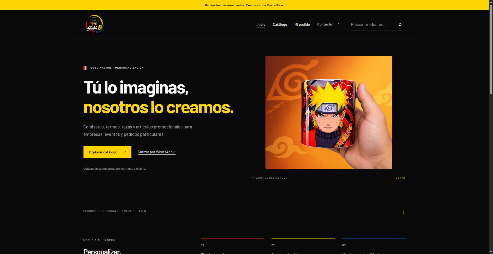
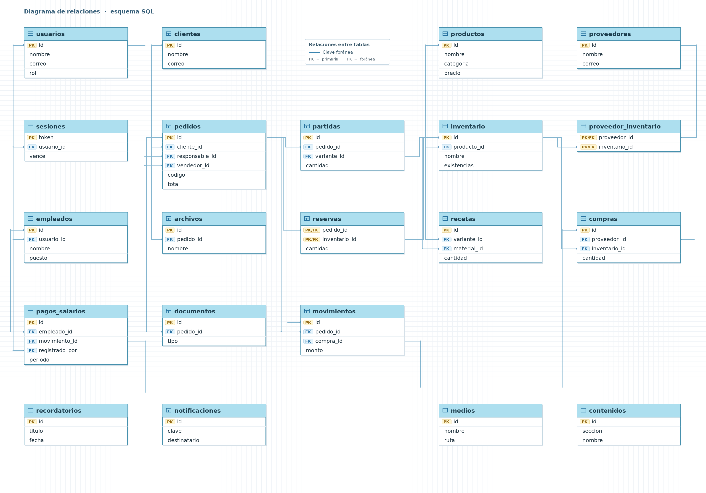

## Subli'B

[Visitar la web](https://subli-b.com/)

Negocio de subliminado personalizado para distintos productos como camisas, vazos, tazas, gorras, etc.
Ubicado en Guapiles, Pococí, Limón, Costa Rica.

Se diseña web ajustada a un presupuesto, la cual debe poseer ciertas caracteristicas orientadas a la administración del inventario, finanzas, calculadora de costos, cotizaciones, y mucho más.

## Documentación:

Para leer el manual del contenido de la web por favor dirigirse a: [https://github.com/duohnson/subli-b/blob/main/documentos/Manual-de-uso-SubliB.docx](https://github.com/duohnson/subli-b/blob/main/documentos/Manual-de-uso-SubliB.docx)
El cual al ser docs solo esta disponible bajo descarga.

Para comprender el uso del sistema de calculadora de precios a cobrar: [https://github.com/duohnson/subli-b/blob/main/documentos/Guia-de-uso-calculadora-precios-SubliB.docx](https://github.com/duohnson/subli-b/blob/main/documentos/Guia-de-uso-calculadora-precios-SubliB.docx)
También disponible solo bajo descarga.

## Bases de datos:

Para comprender como se estructuro y funciona la base de datos, visitese: [https://github.com/duohnson/subli-b/blob/main/documentos/base%20de%20datos/schema.sql](https://github.com/duohnson/subli-b/blob/main/documentos/base_de_datos/schema.sql)

El tiempo con el que se realizo el sitio web fue de aproximadamente 13 días, para el frontend se utilizo la busqueda de plantillas según se acercará mas al gusto del cliente y luego se personalizo, parte del .css fue importado, y se modifico a gusto del cliente.
Todo el trabajo backend y la construcción de la base de datos fue mi propia estructura.

## Licencia

Este proyecto está licenciado bajo Apache License 2.0. Consulta el archivo [LICENSE](LICENSE) para ver los términos completos.
